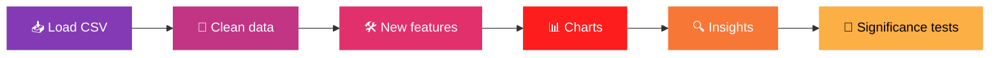
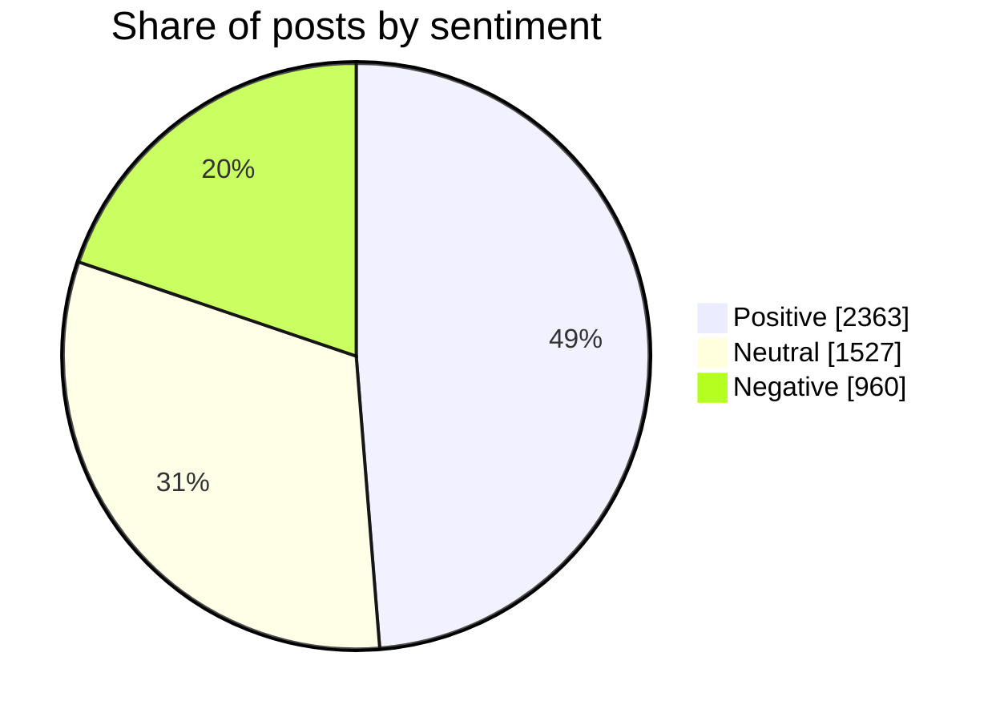

<!-- BANNER -->
<p align="center">
  
</p>

<p align="center">
  
</p>

<p align="center">
  
  
  
  
  
</p>

<p align="center">
  
  
  
  
  
  
  
</p>

---

## 📱 About the Project

An exploratory analysis of **5,000 social media posts** across eight content categories, four post types and ten countries. The notebook cleans the data, builds new engagement features, draws **16 charts** (Matplotlib, Seaborn and interactive Plotly) and finishes by testing whether the differences it finds are real or just chance.

> 💡 **Question it answers:** does the type of post, the topic, the country, the device or the sentiment make a post perform better?

<p align="center">
  
  
  
  
</p>

---

## 🧾 The Dataset at a Glance

| 📊 Posts | 🧱 Columns | 🧹 After cleaning | 📅 Period |
|:---:|:---:|:---:|:---:|
| **5,000** | **19** | **4,850** | **Jan 2022 – Dec 2023** |

| Group | Columns |
|-------|---------|
| 👤 User | `user_id`, `age`, `gender`, `country`, `follower_count`, `is_verified`, `device_type` |
| 📝 Post | `post_id`, `post_type`, `post_category`, `hashtags`, `posted_at`, `sentiment` |
| 📈 Performance | `likes`, `comments`, `shares`, `watch_time_sec`, `impression_count`, `engagement_rate` |

---

## 🔄 Workflow



---

## 🧹 Data Cleaning

| Problem found | What was done |
|---------------|---------------|
| 150 missing values in each of `age`, `gender`, `likes`, `comments`, `shares`, `sentiment` | Numbers filled with the median, missing gender set to `Unknown`, rows with missing sentiment dropped |
| 589 posts (12.1%) had more reactions than impressions, with engagement rates up to 191.5 | Reactions scaled down so no engagement rate is above 1 |
| Dates stored as text (`17-12-2022`) | Converted to dates using the day-month-year format |
| Duplicates | Checked, none found |

**5,000 rows → 4,850 rows**

---

## 🛠️ Features Created

- **Engagement score** = likes + 2 × comments + 3 × shares
- **Engagement rate** recalculated after cleaning
- **Age groups** (13-24 up to 55-64)
- **Day of week** and **month** from the post date
- **Region** added by merging a small country lookup table

---

## 📊 Charts Included

| Library | Charts |
|---------|--------|
| 🎨 **Matplotlib** | Histogram, bar charts, line chart, scatter plot |
| 🌈 **Seaborn** | Box plot, violin plot, heatmap, swarm plot, pair relationships |
| ⚡ **Plotly (interactive)** | Monthly trend lines, country comparison, bubble chart of categories |

---

## 🔍 Key Findings

<table>
<tr>
<td width="50%">

### 🏆 Content
- Text, video and image posts are level at about **0.38** engagement rate; reels are lowest at **0.36**
- Fitness (**0.384**) and music (**0.383**) lead the categories; food is lowest (**0.360**)
- Australia is highest (**0.398**), India lowest (**0.344**)

</td>
<td width="50%">

### 👥 Users and behaviour
- Engagement rate dips slightly with age, **0.382 → 0.355**, but the link is very weak (−0.026)
- Verified accounts: **0.351** against **0.375**, just short of significance (p = 0.055)
- Mobile has the longest watch time (**4,088 s**)

</td>
</tr>
</table>



> 📌 **Main takeaway:** the one strong pattern is that **engagement rate falls as impressions rise** (correlation −0.79), because likes, comments and shares do not grow as fast as reach. Beyond that, the group differences are mostly within chance.

### 🧪 Are the differences real?

| Comparison | Test | p-value | Real difference? |
|------------|------|:------:|:---:|
| Engagement rate by post type | Kruskal-Wallis | 0.825 | ❌ |
| Engagement rate by category | Kruskal-Wallis | 0.976 | ❌ |
| Engagement rate by country | Kruskal-Wallis | 0.331 | ❌ |
| Engagement rate by sentiment | Kruskal-Wallis | 0.985 | ❌ |
| Verified vs not verified | Mann-Whitney | 0.055 | ❌ |
| Impressions by weekday | Kruskal-Wallis | 0.577 | ❌ |

---

## 📂 Project Structure

```
Social-Media-Engagement-Analytics/
│
├── 📓 Social_Media_Engagement_Analytics.ipynb   # Full analysis
├── 📄 social_media_engagement_5000.csv          # Dataset
├── 📘 README.md
└── 📜 LICENSE
```

| File | Description |
|------|-------------|
| [📓 Social_Media_Engagement_Analytics.ipynb](Social_Media_Engagement_Analytics.ipynb) | Notebook with every task, code, output and explanation |
| [📄 social_media_engagement_5000.csv](social_media_engagement_5000.csv) | The 5,000-post dataset |
| [📜 LICENSE](LICENSE) | MIT License |

---

## 🧰 Concepts Used

`pandas` · `numpy` · `matplotlib` · `seaborn` · `plotly.express` · `scipy.stats` · missing value handling · outlier correction · `groupby` · `merge` · date handling · correlation · hypothesis tests

---

## 🚀 Running the Project

1. **Clone the repository**
   ```bash
   git clone https://github.com/AnsaniaSalam/Social-Media-Engagement-Analytics.git
   cd Social-Media-Engagement-Analytics
   ```
2. **Install the libraries**
   ```bash
   pip install pandas numpy matplotlib seaborn plotly scipy jupyter
   ```
3. **Open the notebook**
   ```bash
   jupyter notebook Social_Media_Engagement_Analytics.ipynb
   ```
4. Keep the CSV **in the same folder** as the notebook and run the cells from top to bottom.

> Plotly charts are interactive in Jupyter. On GitHub they may show as static images.

---

## 👩‍💻 Author

<p align="center">
  <b>Ansania Salam</b><br><br>
  <a href="https://www.linkedin.com/in/ansania-salam">
    
  </a>
  <a href="https://github.com/AnsaniaSalam">
    
  </a>
</p>

## 📜 License

This project is licensed under the **MIT License**. See the [LICENSE](LICENSE) file for details.

<p align="center">
  
</p>
